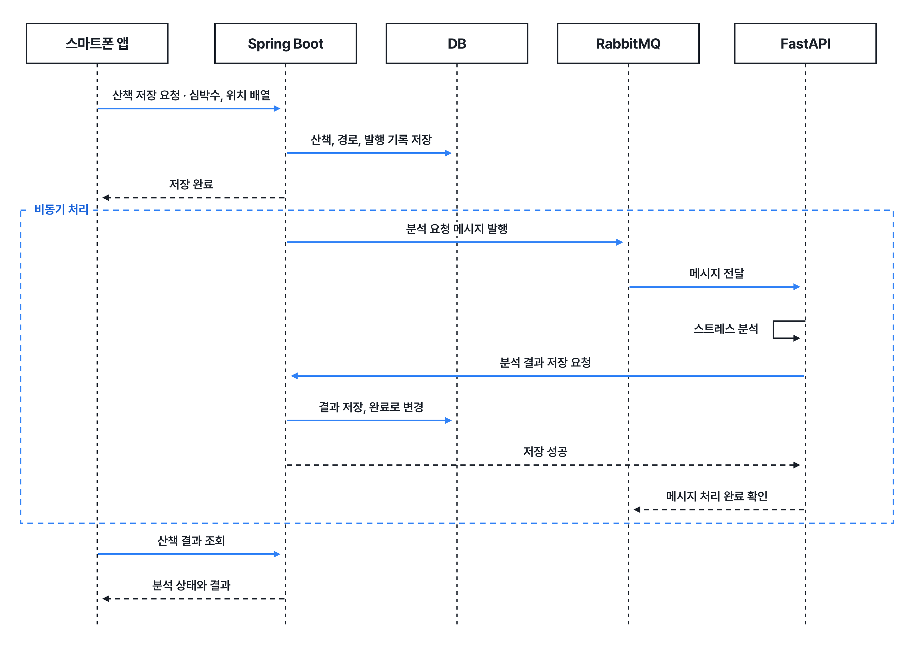
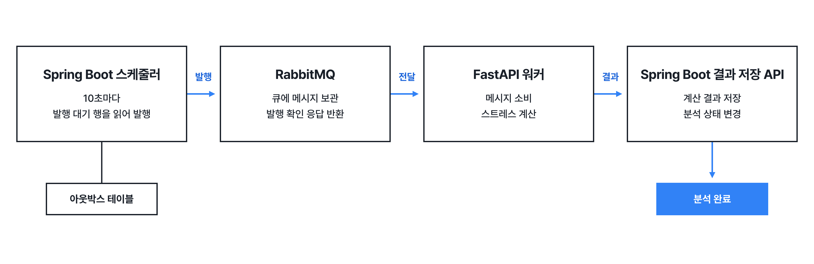
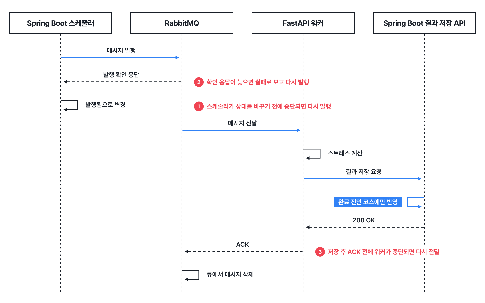

# 🚚 S-Care

<div align='center'>
    
</div>

## ✨ 주제

-   일상 속 스트레스 관리를 함께 해주는 서비스

## 📅 기간

-   2024.10.21 ~ 2024.11.19

## 📜 프로젝트 컨셉 및 주요 기능

### 1️⃣ 기획 배경 및 목적

-   총 130명을 대상으로 설문조사한 결과, 약 41.2%가 **거의 매일** 스트레스를 느낀다고 응답
-   또한 약 90.8%가 **스트레스 관리가 필요**하다고 응답

### 2️⃣ 주요 기능

#### 스트레스 시각화 및 알림

- 나를 투영한 펫이 스트레스 수치에 맞춰서 표정 변화

#### 산책 유도 & 지압 유도 알림

- 스트레스가 **나쁨** 구간에 해당되면 기상청 API를 호출하여 날씨 정보를 조회
- 온도, 습도, 눈/비, 풍속의 상황에 맞춰서 산책 or 지압 중 하나를 사용자에게 제안하는 알림 전송

#### 개인별 통계

- 일주일 동안 S-Care의 솔루션을 사용했던 통계 결과를 조회하여 한눈에 파악

#### 산책하기

- 실시간 위치로 산책 경로를 지도에 표시
- 산책을 3분 이상으로 할 경우, 코스 기록 저장 가능
- 산책을 5분 이상으로 할 경우, 산책 중 제일 스트레스가 낮았던 구간 기록 가능
- 스트레스 분석은 저장 후 비동기로 진행되며, 분석이 끝나기 전에는 결과 화면에 대기 문구 표시

## 💻 개발 환경 및 문서

### 1️⃣ Stacks

#### 🛠 Front-End 🛠


#### 🛠 Back-End 🛠


#### 🛠 CI / CD 🛠


#### 🛠 Tools 🛠


[](https://imminent-hamburger-1d8.notion.site/8-0-4-0fbd317ef9d840bc9d31ea8adfa50ceb)
[](https://www.figma.com/design/7WUqXjKvUcDPLKYMUa9P4Y/%EC%98%B7%EC%A7%B1?node-id=0-1&t=K68NqokoRcvm5jnd-0)

### 2️⃣ Architecture

2024년 프로젝트 당시의 구성입니다. 이후 바뀐 산책 저장 흐름은 아래 [산책 저장 흐름 고도화](#-산책-저장-흐름-고도화-2026)를 참고하세요.

<div align='center'>
  
</div>

### 3️⃣ ERD

<div align='center'>
  
</div>

### 4️⃣ 로컬 실행

MySQL, RabbitMQ, Redis 는 docker compose 로 띄우고 Spring API 와 스트레스 계산 워커는 호스트에서 실행합니다. 자세한 방법은 [backend/README.md](backend/README.md) 에 있습니다.

```bash
cd backend && docker compose up -d --wait
cd api && cp .env.example .env && sh gradlew bootRun
cd ../fast-api && python -m venv .venv && .venv/bin/pip install -r requirements.txt
env $(cat .env.example | xargs) .venv/bin/uvicorn main:app --port 8000
```

## 🔧 산책 저장 흐름 고도화 (2026)

프로젝트 종료 후 이 포크에서 산책 저장과 스트레스 분석 흐름을 다시 설계했습니다. 요구사항과 결정 과정은 [docs/spec/walk-save-improvement.md](docs/spec/walk-save-improvement.md) 에 있습니다.

### 문제

산책을 저장하면 Spring Boot 가 FastAPI 를 동기로 호출해 스트레스를 분석했습니다. 분석 시간이 산책 길이의 제곱에 비례해서, 산책이 길거나 요청이 겹치면 Nginx 의 응답 대기 제한(60초)을 넘겼고 산책은 스트레스 결과 없이 저장됐습니다.

### 현재 흐름

<div align='center'>
  
</div>

- **저장은 즉시, 분석은 비동기로.** 산책은 분석 중 상태로 먼저 저장하고, 분석은 RabbitMQ 를 거쳐 워커가 처리합니다.
- **Transactional Outbox.** 산책 코스, 좌표, 분석 요청 기록을 하나의 DB 트랜잭션으로 저장합니다. 10초 주기 스케줄러가 발행 대기 행을 읽어 발행하고, 브로커의 확인 응답을 받은 뒤에만 발행됨으로 표시합니다.
- **결과 저장 후 ACK.** 워커는 Spring Boot 의 결과 저장 API 에서 200 을 받은 뒤에만 메시지를 ACK 합니다. 실패하면 1초, 2초, 4초 간격으로 재시도한 뒤 데드레터 큐로 보냅니다.
- **멱등한 결과 저장.** 같은 메시지가 다시 전달되어도 조건부 UPDATE 로 한 번만 반영합니다.
- **분석 방식.** 누적 계산을 120 샘플 고정 윈도우로 바꾸고, 평균 스트레스가 가장 낮은 구간을 누적합으로 찾습니다.
- **저장소 통합.** 경로 좌표를 MongoDB 에서 MySQL JSON 컬럼으로 옮겨 산책과 한 트랜잭션으로 저장합니다.

<div align='center'>
  
</div>

### 중복 전달 대비

메시지는 최소 한 번 전달됩니다. 아래 세 지점에서 같은 메시지가 다시 전달될 수 있고, 결과 저장 API 가 한 번만 반영해 흡수합니다.

<div align='center'>
  
</div>

### 결과

2024년 측정값(심박 1,300개 분석에 22초)에 맞춰 CPU 를 제한한 재현 환경에서, 같은 요청을 기존 동기 구조와 현재 구조에 보내 비교했습니다. 30분 산책 기준입니다.

| 상황 | 구조 | 저장 응답 | 분석 결과를 받은 산책 |
| --- | --- | --- | --- |
| 10명이 동시에 산책 종료 | 이전 | 60초 뒤 타임아웃 | 10건 중 0건 |
| | 현재 | 0.06초 | 10건 중 10건 |
| 분석 서버 90초 장애 | 이전 | 60초 뒤 타임아웃 | 54건 중 9건 |
| | 현재 | 0.02초 | 54건 중 54건 |

- 부하가 낮을 때는 이전 구조가 결과를 더 빨리 돌려줍니다. 현재 구조는 릴레이의 10초 주기 때문에 결과까지 중앙값 8초가 걸립니다.
- 수치는 2024년 서버에서 잰 값이 아니라 재현 환경의 값이고, 심박은 합성 데이터입니다.

### 문서

| 문서 | 내용 |
| --- | --- |
| [docs/spec/walk-save-improvement.md](docs/spec/walk-save-improvement.md) | 요구사항, 목표 구조, 채택하지 않은 것과 이유 |
| [backend/fast-api/experiments/RESULTS.md](backend/fast-api/experiments/RESULTS.md) | 윈도우 크기 실험 |
| [backend/loadtest/RESULTS.md](backend/loadtest/RESULTS.md) | 이전 구조와 현재 구조의 부하 비교 |
| [backend/README.md](backend/README.md) | 로컬 실행 방법 |
