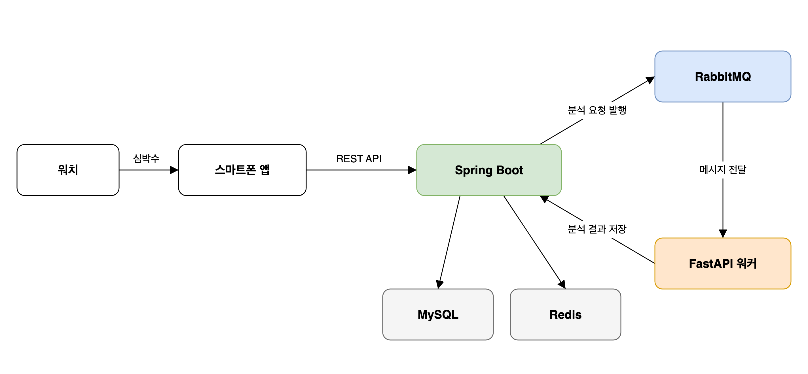

# 🚚 S-Care

<div align='center'>
    
</div>

스마트 워치를 이용한 실시간 스트레스 모니터링 서비스

- **기간**: 2024.10 ~ 2024.11
- **팀**: 6인
- **수상**: 프로젝트 결선 발표회 입상 (141개 팀 중 상위 8팀)

워치로 측정한 심박수로 스트레스 지수를 계산해 보여주고, 스트레스가 높아지면 날씨에 맞춰 산책이나 지압을 제안합니다. 산책을 마치면 경로와 함께 스트레스가 가장 낮았던 구간을 지도에 표시합니다.

## 핵심 구현

### 심박 데이터 기반 스트레스 지수 계산

Samsung Health SDK 가 스트레스 지수를 제공하지 않아, 실시간 심박수를 스트레스 지수로 변환하는 알고리즘을 구현했습니다.

- 심박수로 추정한 박동 간격에서 SDRR, RMSSD, LF/HF 지표를 계산합니다. 계산 방식은 pyHRV 를 참고했습니다.
- 지표별 가중치를 적용해 스트레스 지수를 산출합니다.

코드: [calculate_service.py](backend/fast-api/services/calculate_service.py)

### 슬라이딩 윈도우와 누적합으로 힐링 구간 탐색

- 슬라이딩 윈도우 크기별로 테스트해 결과를 비교하고, 노이즈와 구간 탐지율을 고려해 윈도우 크기를 정했습니다.
- 스트레스 지수가 가장 낮은 산책 구간을 찾기 위해 누적합으로 연속 구간별 평균을 계산하고 O(N) 에 탐색합니다.
- 수정보다 경로 전체를 조회하는 일이 많은 특성을 고려해, 산책 경로 좌표를 배열로 묶어 MySQL JSON 컬럼에 저장합니다.

코드: [stress_overview_service.py](backend/fast-api/services/stress_overview_service.py) · 실험: [experiments/RESULTS.md](backend/fast-api/experiments/RESULTS.md)

### 메시지 큐 기반 비동기 분석과 장애 복구

- 산책 중 스트레스 변화 계산이 지연되어 발생한 API 타임아웃을 RabbitMQ 기반 비동기 처리로 해결했습니다.
- 산책 저장과 분석 요청 기록을 하나의 트랜잭션으로 묶는 Transactional Outbox 를 적용하고, 스케줄러가 브로커로 발행합니다.
- At-least-once 전달에 따른 중복 요청에 대비해, 컨슈머가 호출하는 결과 저장 API 를 조건부 UPDATE 로 멱등하게 구현했습니다.
- 컨슈머는 결과 저장에 성공한 뒤에만 메시지를 ACK 하고, 실패하면 재시도 후 데드레터 큐로 보냅니다.
- 동시 요청과 컨슈머 장애 시나리오를 샘플 데이터로 테스트해 분석 결과가 유실되지 않음을 확인했습니다.

설계 문서: [docs/spec/walk-save-improvement.md](docs/spec/walk-save-improvement.md)

## 개발 환경

### Stacks

#### 🛠 Front-End 🛠


#### 🛠 Back-End 🛠


#### 🛠 CI / CD 🛠


#### 🛠 Tools 🛠


[](https://imminent-hamburger-1d8.notion.site/8-0-4-0fbd317ef9d840bc9d31ea8adfa50ceb)
[](https://www.figma.com/design/7WUqXjKvUcDPLKYMUa9P4Y/%EC%98%B7%EC%A7%B1?node-id=0-1&t=K68NqokoRcvm5jnd-0)

### Architecture

<div align='center'>
  
</div>

### ERD

<div align='center'>
  
</div>

### 로컬 실행

MySQL, RabbitMQ, Redis 는 docker compose 로 띄우고 Spring API 와 스트레스 계산 워커는 호스트에서 실행합니다. 자세한 방법은 [backend/README.md](backend/README.md) 에 있습니다.

```bash
cd backend && docker compose up -d --wait
cd api && cp .env.example .env && sh gradlew bootRun
cd ../fast-api && python -m venv .venv && .venv/bin/pip install -r requirements.txt
env $(cat .env.example | xargs) .venv/bin/uvicorn main:app --port 8000
```
